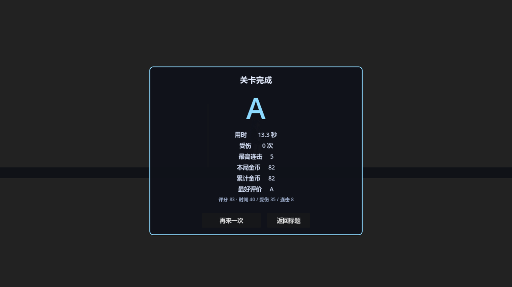

# 自我开发——拯救（Self-Development: Salvation）

2D 横版动作竖切片，Godot 4.7 / GL Compatibility，灰盒 M1（v0.2）。
可玩流程：标题页（开始 / 继续）→ 关卡（4 只木桩 / 2 个检查点自动存档 / Boss「夜巡」）→ 结算页（S/A/B 评价）→ 重开或回标题。



## 目录结构

```
.
├─ game/                    # Godot 工程（用 Godot 打开这个目录）
│  ├─ project.godot
│  ├─ autoload/            # Data / Fx / Save / Settings / Audio 五个全局单例
│  ├─ data/                # player.json / enemies.json / boss.json（全部可调数值）
│  ├─ scenes/
│  │  ├─ player/           # player.tscn + player.gd + camera_shake.gd
│  │  ├─ enemies/          # enemy_dummy.* / boss.*
│  │  ├─ combat/           # rect_query.gd（木桩与 Boss 共用的矩形判定）
│  │  ├─ levels/           # level.tscn + level.gd（唯一关卡）
│  │  └─ ui/               # title / hud / pause_menu / settings_panel / tutorial / debug_panel / results
│  ├─ art/player/          # 本地立绘目录（公开仓库不含；缺失时角色回落为占位图形）
│  ├─ audio/{bgm,sfx}/     # 占位 BGM / 20 个音效
│  └─ tests/               # 无界面冒烟测试 smoke_test.tscn
├─ docs/
│  ├─ prd/                 # 需求文档 v0.2、v0.1 评审建议、v0.2 总结
│  ├─ assets/              # 文档/评审用截图与标注图
│  ├─ 架构与逻辑说明.md
│  ├─ 代码审查报告.md
│  ├─ 工程规范.md
│  ├─ 代码规约.md
│  └─ 迭代计划.md
├─ tools/
│  ├─ check.py             # 门禁：静态检查 + 可选 Godot 冒烟
│  ├─ docs/                # PRD / 评审 DOCX 生成、编辑器截图标注
│  ├─ assets/              # 立绘抠图、占位音效生成
│  └─ archive/             # 已执行的一次性 codemod（仅留档，不再运行）
├─ .github/workflows/       # CI：只跑静态门禁（不需要 Godot）
├─ .githooks/pre-commit    # 提交前静态门禁（需 git config core.hooksPath .githooks）
├─ LICENSE                 # 代码许可（MIT）
├─ NOTICE.md               # 素材与文档的版权声明
└─ README.md
```

## 快速开始

环境：Godot **4.7.x**（工程 features 为 `"4.7"`；PRD 写的是 4.4，升级后未回写文档）。
把 Godot 可执行文件路径写进 `GODOT_BIN`（Windows 的 console 版与图形版都可以）：

```powershell
$env:GODOT_BIN = "C:\path\to\Godot_v4.7.2-stable_win64_console.exe"

# 1) 首次导入资源（生成 game/.godot 缓存，可随时删除重建）
& $env:GODOT_BIN --headless --path game --import

# 2) 启动游戏（从标题页开始）
& $env:GODOT_BIN --path game

# 或者用编辑器打开 game/project.godot 后按 F5
```

单独跑某个场景：

```powershell
& $env:GODOT_BIN --path game res://scenes/levels/level.tscn
& $env:GODOT_BIN --path game res://scenes/ui/title.tscn
```

## 操作

| 动作 | 键鼠 |
| --- | --- |
| 移动 | A / D |
| 跳跃（二段跳） | 空格 / W |
| 普攻（地面三连、空中两段） | 鼠标左键 / J |
| 闪避（前 3 帧无敌） | Shift / U |
| 橙闪突进（K，6 秒 CD） | K |
| 逆鳞范围击退（L，10 秒 CD，2 秒霸体） | L |
| 零点全屏斩（I，能量满可用，吃连击加成） | I |
| 暂停 | Esc |
| 调试面板显隐 | F1 |
| 调试：无敌 / 秒杀最近敌人 / 传送到 Boss 前 / 冻结 AI / 碰撞形状 | F2 / F3 / F4 / F5 / F6 |
| 调试控制台（`god` / `freeze` / `kill` / `warp <x>` / `help`） | `（反引号） |

## 自动化测试

冒烟测试不依赖画面与音频设备，覆盖 Data / Save / Results / Player / Enemy / Level / Boss / Audio / Debug：

```powershell
$save = "$PWD\_backup\test-save"
$env:SALVATION_SAVE_DIR = $save                                # 隔离存档，避免写真实 user://
& $env:GODOT_BIN --headless --path game res://tests/smoke_test.tscn
echo $LASTEXITCODE    # 0 = 全过，1 = 有失败项
```

当前基线：**134 项断言全部通过，退出码 0**。测试会先删掉并重建 `SALVATION_SAVE_DIR` 目录，顺带验证「目录不存在时自动创建」；若该路径不可写，Save 组会失败（属环境问题）。

一键门禁（静态检查 + 可选 Godot 冒烟）：

```powershell
python tools/check.py          # Python / JSON / 文本卫生 / GDScript 基础检查
python tools/check.py --godot  # 追加冒烟测试与 level/title 场景
```

仓库自带 `.githooks/pre-commit`，启用后每次提交自动跑 `--fast`：`git config core.hooksPath .githooks`。
GitHub Actions 只跑 `python tools/check.py`（静态 12 项，不需要 Godot）；带 Godot 的冒烟与场景回归仍在本地跑。

真窗口自动验收（开窗、注入按键、截图、采帧率，约 40 秒）：

```powershell
$env:SALVATION_SHOT_DIR = "$PWD\_backup\shots"
& $env:GODOT_BIN --path game res://tests/auto_accept.tscn --resolution 1280x720
echo $LASTEXITCODE    # 0 = 25 项全过；截图与 auto_accept.json 在 $SALVATION_SHOT_DIR
```

它覆盖按键到起手、三连伤害、闪避位移、L/I 技能、检查点写档、Boss 激活、结算与帧率；听感与手感仍需按[验收清单](docs/验收清单.md)人工确认。

## 数值调参

所有战斗数值在 `game/data/*.json`，启动时由 `Data` 加载并与内置默认值深合并：

- `player.json`：移动/跳跃、三段普攻帧数据、跳攻、闪避、橙闪、逆鳞/零点、能量与受击反馈
- `enemies.json`：木桩血量/攻击距离/前摇/击飞阈值
- `boss.json`：Boss 血量、阶段阈值、三连斩/跳劈/召唤参数

改完 JSON 在调试器里执行 `Data.reload()` 即可热重载；M1 未实现「游戏中按 F5 自动重载」，不要在文档里承诺该快捷键。
格式固定为 2 空格缩进（见[代码规约](docs/代码规约.md) DATA-1/DATA-2）。字段缺失回落到 `game/autoload/game_data.gd` 里的 `DEFAULT_*`；类型不对（如把 `move` 写成数字）会告警并保留默认值，不会让角色脚本崩。默认表与 JSON 的重叠字段必须同值，冒烟测试会断言（规约 DATA-6）。

## 存档

- 默认路径：`%APPDATA%\Godot\app_userdata\salvation\save.json`，上一份为 `save.bak`
- 环境变量 `SALVATION_SAVE_DIR` 可把存档重定向到任意目录（自动化测试/沙箱用）；目录不存在时会自动创建
- 写档顺序：`save.tmp` → 旧档改名 `save.bak` → tmp 改名主档；任一步失败保留旧档，主档损坏时读 `save.bak`
- **检查点自动存档（R11）**：踩到检查点即写档（`progress.checkpoint`），最后一个检查点「神龛」额外记录 `progress.shrine_taken` 并只回满一次血与能量；标题页「继续」从该检查点开始，「开始游戏」清空进度重开；通关后进度自动清空
- 存档字段：`version / gold / best_grade / best_time / clears / settings{bgm,sfx,shake,numbers,tutorial} / progress{checkpoint,shrine_taken}`；`version` 已升到 2，v1 旧档自动补默认进度；字段类型异常按默认值丢弃，不会崩

## 工具链

需要 Python 3.10+ 与 `python-docx`、`Pillow`、`numpy`：

```powershell
python tools/docs/build_prd_v02.py         # 生成 docs/prd/游戏需求文档_v0.2.docx（可传输出路径）
python tools/docs/build_review_docx.py     # 生成 docs/prd/游戏需求文档_v0.1_评审与扩展建议.docx
python tools/docs/annotate_editor.py       # docs/assets/editor_source.png → editor_标注.png
python tools/assets/import_player_art.py   # 绿幕立绘 → game/art/player/idle.png
python tools/assets/make_sfx.py            # 重新生成 game/audio 下的占位 wav
```

所有脚本都用「脚本自身位置向上三层」定位仓库根目录，移动脚本目录时不需要改路径常量。

## 文档

- [架构与逻辑说明](docs/架构与逻辑说明.md)：启动链路、状态机、战斗结算、AI、关卡与 UI 数据流
- [代码审查报告](docs/代码审查报告.md)：按 P1/P2/P3 分级的问题清单、PRD 差异矩阵、修复建议
- [工程规范](docs/工程规范.md)：目录职责、文件归位、流程与测试要求
- [代码规约](docs/代码规约.md)：引用 Godot / PEP 8 / Google JSON / Conventional Commits 的代码级规则（MUST/SHOULD）
- [验收清单](docs/验收清单.md)：PRD 10 条验收到「按键 → 预期现象」的操作步骤，配合 F2–F6 调试键使用
- [迭代计划](docs/迭代计划.md)：R11–R18 的排期、任务卡、检测体系与审查机制
- [PRD v0.2 总结](docs/prd/游戏需求文档_v0.2_总结.md)：需求基线（Markdown 版）

## 已知限制

- 技能已补齐 K / L / I 三个；手柄、`strings.csv`、`export_presets.cfg` 仍未落地；音效侧 L / I 暂复用重击声，未单独生成素材。
- 存档已实现 `save.bak` 回滚与目录自动创建；`fsync` 未实现（Godot `FileAccess` 不暴露），验收口径为「主档或 bak 至少一份可用」。
- 角色/敌人/UI 均为代码绘制的灰盒，无 AnimatedSprite2D 与动画资源；公开仓库不含角色立绘，未放入 `idle.png` 时角色显示为灰盒占位。
- `audio/sfx/hit_player.wav` 为素材预留，当前没有代码播放；其余音效均已接入。
- 其余仍待排期的问题（P2/P3）见[代码审查报告](docs/代码审查报告.md) §7。

## 许可

- 代码（`game/` 下的 `.gd` / `.tscn` / `.json`、`tools/` 下的 Python、根目录配置与脚本）以 **MIT** 发布，见 [LICENSE](LICENSE)。
- 素材与文档图片（`game/audio/`、`docs/prd/`、`docs/assets/`）**不在 MIT 范围内**，版权归作者保留，未经许可不得再分发或商用，见 [NOTICE](NOTICE.md)。
- **本仓库不包含角色立绘**：`game/art/player/` 已被 `.gitignore` 排除（AI 生成素材仅本地保留）。缺失时 `player.gd` 会自动回落到灰盒 Body/Eye 占位图形，游戏与测试都能正常跑；如需启用立绘，把 `idle.png` 放回该目录即可。
